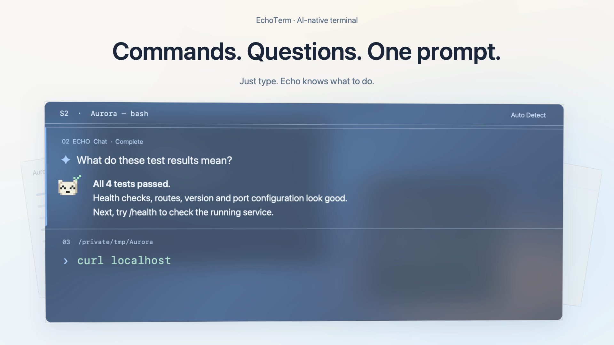

# EchoTerm

命令与 AI，在同一个入口。一个简洁的 macOS 原生终端，基于 SwiftUI、AppKit 与 SwiftTerm。当前版本：**0.11.5**。



- **统一输入**：命令直接执行，自然语言进入 AI 对话，也可以手动指定输入方式。
- **Block 终端**：命令、输出与 AI 回答按时间排列，保留状态、耗时与用量信息。
- **跨会话定位**：Echo 按需读取其他 Session 的 Block，并跳转、高亮匹配内容。
- **像素 Echo**：表情、流动像素和工作状态相互对应。
- **轻量界面**：多标签与分屏、悬浮时间轴、多种主题、可调透明度与毛玻璃材质。

[英文宣传片 · 46 秒](promo/v10-en/output/EchoTerm-Promo-English-v10-46s.mp4) · [中文宣传片 · 46 秒](promo/v8/output/EchoTerm-Promo-v8-46s.mp4) · [宣传片工程](promo/README.md)

## 启动

### 下载应用

[GitHub Releases](https://github.com/tankecho42/EchoTerm/releases/latest) 提供可直接下载的应用包。下载对应版本的 `EchoTerm-版本-macOS-arm64.zip`，解压后将 `EchoTerm.app` 拖入「应用程序」即可，无需安装 Swift 或 Xcode。当前下载包适用于 Apple Silicon Mac，要求 macOS 14 或更新版本。

本版本使用 ad-hoc 签名，尚未经过 Apple 公证。首次打开若被 macOS 阻止，请确认下载来源，再按 [Apple 官方指引](https://support.apple.com/en-us/102445)，在尝试打开后进入「系统设置 → 隐私与安全性 → 仍要打开」。AI 功能需要在设置中配置自己的 Provider、模型与 API Key。

### 从源码构建

需要 macOS 14+、Swift 6.1+（Xcode Command Line Tools 即可），首次构建需要网络下载 Swift Package 依赖。

```sh
./scripts/run.sh
```

安装到应用列表：将生成的 EchoTerm.app 放入 `/Applications`，或用 `ditto --norsrc --noextattr "$HOME/Library/Application Support/EchoTerm/Builds/EchoTerm.app" /Applications/EchoTerm.app` 安装构建实体。更新正在运行的版本前请保留所需会话内容。

生成的 App 入口位于 `dist/EchoTerm.app`，可以双击打开；同目录提供可分发的 `EchoTerm.zip`。为避开 Documents 的 File Provider 元数据干扰签名，可运行实体存放在 `~/Library/Application Support/EchoTerm/Builds/EchoTerm.app`，`dist` 中是指向它的链接。可用 `ECHOTERM_BUILD_ROOT` 自定义构建存放目录。只构建：`./scripts/build-app.sh debug`；发布优化构建：`./scripts/build-app.sh release`。当前为本机 ad-hoc 签名，不是已公证的公开发行版本。

```sh
./scripts/test.sh              # 核心逻辑 + 真实 PTY 检查（无须 XCTest）
./scripts/test.sh --network    # 另启本地 SSE fixture，验证真实网络流式链路（需要 Python 3）
swift test                     # XCTest 测试（需要完整 Xcode）
./scripts/run.sh --demo         # 展示明确标识的示例 AI 气泡，终端仍是真实 shell
```

## 0.11.5 的主要变化

- 修复滚到密集 AI 列表、表格或超长段落时的严重卡顿：这类内容使用固定高度的完整文本视图，支持内部滚动、选择和复制，避免一次创建数千个文本组件；普通回答继续显示 Markdown 格式。
- 向上滚动时立即暂停追随底部，滚回最新位置后恢复；内部长文本视图单独滚动。布局变化只能触发有限次数的底部位置修正，防止滚动与布局互相反复触发。

## 0.11.4 的主要变化

- 连续提问会直接附带所选 Block 中的提问、回答与命令结果。“好的”“继续”能接上上一轮回答，工具续答不会变成重复的用户问题。
- AI 输入旁显示当前会话的上下文 Block 范围和估算 token 数，点击后可用滑条调整最早纳入的 Block。
- 最早纳入的 Block 上方显示上下文边界，使用上、下箭头扩大或缩小范围；范围变化与实际请求使用同一份内容。
- 正在执行的请求固定上下文范围，关闭上下文分享时不附带历史内容；长内容有上限并标明截断。token 为附带内容的估算，不等同于模型计费。
- 可选的快速意图和 AI 命名也遵守各会话所选历史范围；它们的独立请求不计入对话输入旁的 token 估算。

## 0.11.3 的主要变化

- 普通上下键切换当前 Session 的命令历史。输入了前缀时，只匹配相同前缀；向下回到最新位置会恢复原草稿，手动编辑后从新前缀重新查找。
- 灰色预览改用右方向键接受，仅在光标位于整行末尾、没有选区时生效；光标右侧仍有文字时正常移动，不覆盖已有内容。
- Tab 打开同前缀的历史命令菜单，重复命令按最后一次出现去重，越新的越靠近光标。上下键选择，右方向键或 Return 只填入输入框；再次 Return 才提交，Escape 关闭菜单并保留草稿。
- 灰色预览继续支持现有的命令名和路径补全；Tab 菜单只列真实历史命令，不执行候选或启动额外 Shell。

## 0.11.2 的主要变化

- 上一条命令结束后，当前面板自动回到最新 Block 的输入框；点击 Block 的空白区域也可直接输入，保留现有草稿。
- 运行输出默认跟随底部；手动上翻暂停，回到底部恢复。原生终端、Block 记录与长输出分别维护滚动位置，TUI 保持自身滚动行为。
- 设置新增「选中文本后自动复制」，默认关闭；开启后适用于终端输出、历史记录和 AI 回答，编辑输入框不参与。
- 修复切回 Block 视图后 Ctrl+C 无法中断当前命令；原生键盘与 TUI 仍按原有输入方式处理，设置和其他输入框保留自己的按键。

## 0.11.1 的主要变化

- 命令运行时默认显示原生终端，直接接收键盘输入；AI 执行的命令同样支持 y/n、单键确认、方向键和全屏 TUI。结束后回到 Block。
- 需要文本框或预设按钮时，主动点击「辅助输入」；关闭后返回键盘。展开或收起不会发送内容，终端提问卡不会自动占用输入焦点。
- 用户开始原生交互或进入备用屏幕后，AI 等待原命令结束，暂停自动执行超时；尚未交给用户的普通自动命令仍保留时限。停止与关闭会话仍可结束任务。
- 原生键盘输入不会被复制为提问工具的回答；旧卡片和晚到的旧提示会失效，防止同一答案再提交一次。

## 0.11.0 的主要变化

- AI 需要你决定下一步时，可直接显示选项按钮与自定义回答。回答后继续同一轮任务，内联与对话气泡共用同一个问题，重复点击不会重复提交。
- 自主执行支持交互命令：AI 读取实际运行输出后，可把终端的问题变成选择或输入卡。卡片明确标出目标命令，回答以一行内容发送给原命令；命令结束、任务停止或会话关闭后卡片失效。
- 等待用户回答的时间不计入目标命令的执行超时。AI 不会仅凭命令安静或输出标点就宣称命令正在等待输入。
- 普通运行命令也提供折叠的「向命令输入」入口，支持发送一行、仅发送 Return 或中断。密码等敏感内容请在原生终端中输入，不通过 AI 提问卡提交。

从源码打包时，可用 `ECHOTERM_DIST_ROOT` 指定 ZIP 与应用入口的输出目录；`ECHOTERM_BUILD_ROOT` 仍指定运行应用实体，临时签名目录仍遵循 `TMPDIR`。

## 0.10.11 的主要变化

- Vim 等使用备用屏幕的程序自动占满当前终端面板，移除重复的 Block 文本快照和 320 pt 的交互区高度限制。手动交互视图使用同一个完整视口。
- 终端视口挂载或切换标签时恢复键盘焦点；设置、对话输入和其他标签不会被后台终端抢焦点。Esc、方向键和控制键直接交给交互程序。
- 窗口或分屏尺寸变化同步更新终端网格、PTY 与输出记录尺寸，并通过 SIGWINCH 通知程序重绘。退出后回到原有 Block 和下一行输入，不把全屏编辑器内容保存成重复输出。
- 新增 Zsh / Bash 下真实 Vim 的 Unicode 编辑保存、大小变化、退出与后续命令回归检查。

## 0.10.10 的主要变化

- 应用图标移除左上角三点和顶部细线；熊掌放大为右上方浅色背景，前景保留清晰的终端提示符。更新全部图标尺寸与预览。

## 0.10.9 的主要变化

- 重绘应用图标：石墨色终端窗口、浅色 `>_` 提示符、鼠尾草绿小熊爪。用矢量脚本独立生成各尺寸，细节在小尺寸下适当简化。
- 图标文件为 `assets/EchoTerm.icns`；1024 px 透明 PNG、256 px 预览与深浅背景尺寸对照也保存在 `assets/`。
- 重新生成：`swift scripts/make-icon.swift /tmp/EchoTerm.iconset assets`，然后 `iconutil -c icns /tmp/EchoTerm.iconset -o assets/EchoTerm.icns`。

## 0.10.8 的主要变化

- 历史 AI 标记改为绿色像素对勾，移除外围圆环；继续由原头像方块流动重组而成。
- 发送新问题时，Echo 从透明、分散的像素聚合成“收到任务”的表情，完整停留 1 秒后流动切换到双环思考。请求与输出不等待动画；若模型已返回，会接着展示实际回答 / 完成状态。工具续答、历史回看不重复入场。
- 标题栏对话气泡支持点击窗口内气泡外部收起；点击内部空白、编辑输入正常，草稿与正在进行的回答保留。

## 0.10.7 的主要变化

- 历史 AI 回答的圆环对勾改为 Echo 同款 14 × 14 像素网格，保持相同方块尺寸与配色。
- 新 AI Block 出现时，旧 Echo 的像素从当前表情流动重组成圆环对勾，完成后停止刷新。回看历史直接显示已归位的像素图形，不重播动画。眨眼继续直接切换。

## 0.10.6 的主要变化

- 眨眼与眨单眼直接切换闭眼、睁眼帧，不再经过像素流动；其他表情与工作状态仍保留像素过渡。
- 每个终端会话只在最新 AI 回答 Block 显示 Echo 头像。新 AI Block 一出现，旧回答改为静态圆环对勾并移除头像动画任务；普通 Shell Block 不影响最新 AI 头像。

## 0.10.5 的主要变化

- 设置导航、主题卡片、分段选项、工作模式、下拉框和普通按钮补齐整个可见区域的点击范围；用量页翻页按钮扩大至 26 pt。
- 侧栏悬停展开时显示固定按钮；固定后常驻并为终端留出空间，取消固定恢复悬停展开。固定偏好保留到下次启动。
- 标题栏 Echo 偶尔随机眨眼、眨单眼、侧看或微笑；AI Block 完成表情保留 5 秒后恢复普通表情，空闲时偶尔眨眼。回看历史不重播完成动画。
- 表情切换时像素逐列流动重组，快速连续切换会从当前画面接着变化。思考动画改为两圈反向旋转的同心像素环。
- 空闲动画按短时片段调度；后台应用、隐藏标签页暂停刷新，遵循系统“减少动态效果”。

## 0.10.4 的主要变化

- 左侧标签栏移入展开、移出收起，不再提供展开、折叠或固定按钮；旧的固定偏好不影响新行为。新建标签按钮紧跟列表末尾，标签悬停时显示高亮、描边和关闭按钮。横向标签也在悬停时显示关闭按钮。
- 当前命令或整轮 AI 回答结束后才显示下一输入 Block。工具命令执行时不再提前创建后续 AI 回答块；普通命令的交互输入仍在当前 Block 内。
- 忙碌时的新提交不会插入额外 Block，草稿保留。完成后恢复输入焦点；已跳转到历史的阅读位置不受影响。
- 完成表情的鼻子下移一格，保持无嘴巴。设置页移除陪伴式文案，使用简短功能名称和必要说明。

## 0.10.3 的主要变化

- 设置开关的整行点击区域至少 32 pt 高；文字、空白处和滑块都由同一个按钮接收点击。
- 设置与标签设置改为应用内浮层，解决系统模态 sheet 打开时退出操作不响应的问题。⌘Q、应用退出菜单走原有统一退出流程，运行中命令仍需确认；退出确认始终位于设置上方。
- 设置打开时暂停底层终端输入和自动抢焦点；关闭后恢复输入，保留现有草稿。小窗口中设置面板随可用高度收缩，内容可以滚动。

## 0.10.2 的主要变化

- 设置侧栏、模型页和关于页统一使用代码绘制的像素 Echo；悬停时眨眼，完成表情保留眼睛、鼻子与对勾，移除嘴巴。动画遵循“减少动态效果”。
- 时间轴闲置时缩至 66%、降低不透明度并贴近右边缘；悬停后平滑展开，继续按距离放大附近节点。10 / 20 / 30 等序号保留可读字号。
- AI 回答 Block 左侧显示蓝色细边，非零退出码的 Shell Block 显示红色细边，正常命令保留原样。时间轴节点使用相同语义颜色，深浅主题分别适配。

## 0.10.1 的主要变化

- 固定/折叠侧栏与窗口共享背景，不再叠加 97% 不透明底色；临时展开的侧栏使用相同透明度和毛玻璃材质。
- 移除终端内容左 20、右 52、顶部 25 与底部 45 像素的外部留白。Shell、AI 与输入 Block 的背景/分界线铺满面板，正文保留内部阅读间距；右侧时间轴直接悬浮，不预留列宽。分屏同样适用。
- 历史查找 Prompt 明确优先顺序：内部概览 → 按需 `list_blocks` / `read_block` → 确认匹配后 `jump_to_block`。覆盖先前命令、提问、回答和共同操作的例子；区分用户输入、Echo 执行与仅在对话中提到的命令。
- 已合理检索内部记录却未找到时才考虑 Shell History；用户明确指定 Shell History 时尊重其来源选择。问答模式始终不能执行 Shell，查询额度用完或上下文关闭不能作为绕过内部检索的理由。Prompt 引导模型选择，具体效果仍取决于所用模型。

## 0.10 的主要变化

- 时间轴的第 10、20、30… 个节点常驻显示序号，保留随距离连续放大的悬浮效果。
- 窗口标题与分屏标题显示 S1、S2… Session 编号；每个会话内部的 Block 从 1 编号，与时间轴一致。
- 新增 `read_block`、`jump_to_block` 和 `list_blocks`，问答与自主模式均可用。例如：“查看 Session 2 的 Block 10，帮我解释输出，然后跳转过去”。
- 每轮只自动附带各 Session 的 Block 输入开头、类型和状态。Echo 按需读取详情，单页最多 16,000 字符；大工作区概览到 60,000 字符后明确提示分页读取索引。每轮最多 24 次历史查询 / 导航，再留一次总结机会。
- 跳转切换到对应标签与分屏，高亮两次，并保留阅读位置。减少动态效果开启时改为一次静态高亮。编号因清理或重排而失效时返回错误，不定位到替代内容。
- 读取和导航不执行命令、不修改草稿；关闭“附带终端上下文”时同时关闭这些工具。索引仅覆盖内存中现存记录，每个 Session 最多保留 300 个区块，已清理输出无法恢复。

## 0.9 的主要变化

- 修复滚动/重绘时输入框与原生控件反复重设样式造成的持续布局循环；长命令与输出采用有限高度、按可见区域排版的文本视口。Markdown 后台解析，命令判断不再在每次滚动重算。超过 100 KB 的 AI 回复切为明确标注的完整原文视图。
- 应用内按钮、下拉选项、开关、滑杆、分段选择、标签右键菜单、关闭确认使用 Echo 自绘样式；菜单支持上下键、Return 与 Esc。底层文本编辑、辅助功能、窗口和系统菜单栏仍使用 macOS 基础能力。
- 背景不透明度支持 10%–100%；毛玻璃提供通透、柔和、磨砂三种系统材质。公开 NSVisualEffectView API 不暴露可设置的像素模糊半径，因此此版本不宣称精确半径控制。
- 每轮 AI 最后一段回答底部显示输入、输出、总 Token 和整轮耗时；自主操作的多次模型调用合并统计，中间回答不重复显示。
- 设置新增「用量统计」，支持按天、周、月、总计查看，包含趋势图、模型拆分和请求用途。快速意图、AI 标签命名、连接测试也计入全局记录。
- 用量来自接口实际返回，不估算缺失值；中断或失败时保留已知用量。缓存和推理是输入/输出的子项，不重复相加。
- 用量历史仅存本机，不存聊天正文或密钥。从本版本起开始记录，升级前历史无法回填。不同 Provider 的统计口径以实际接口为准，不能替代供应商账单。
- 原有石墨、午夜、纸白之外新增雾蓝、鸢尾、琥珀、暖瓷；同时调整界面、终端背景/文字/光标与原生交互终端的 ANSI 色板。命令有效性仍使用语义绿/红。
- 旧 OpenAI 兼容网关若不接受流式用量参数，可在 Provider 的「流式用量兼容性」中关闭该选项后保存。

## 0.8.2 的调整

白熊头像降为 14 × 14 网格，颗粒大小翻倍，五官更抽象。像素头像只保留居中的白熊头部，去掉下方披风；执行命令时角落像素符号依次亮起。

## 0.8 的主要变化

- Echo 改为白熊像素头像：思考时像素重排成走马灯、回答时逐点亮起、执行命令时围巾扫光、完成时笑脸和对勾；异常与停止有独立表情。
- 右侧是紧凑的悬浮节点时间轴，相邻节点按距离连续放大。长历史在短轨内滚动，半透明小卡片预览输入和输出，点击跳转。
- 设置和关于页加入参考图衍生的透明白熊插画，标题栏、标签设置、意图建议加入白熊和熊爪元素。资源随应用打包。
- 遵循系统“减少动态效果”；历史头像平时静止，持续动画仅用于正在工作的头像。

## 0.7 的主要变化

- 标签页有独立的默认输入方式（自动 / 终端 / AI）与 AI 工作模式（问答 / 自主操控），其分屏共用默认值。右键标签 →「标签设置与重命名」修改。
- Block 输入方式使用原生 `NSPopUpButton`，点击直接显示选项。临时覆盖仅用于当前输入，提交后恢复标签默认值；模式会记录在对应 AI Block 上。
- 设置新增「标签页」：新标签默认模式，以及路径、最近命令、AI 概括三种自动命名规则。手动名称优先，清空后恢复自动命名。
- AI 命名使用配置的快速 Provider / 模型、关闭思考、96 token 上限与 8 秒截止，只取近期少量上下文；自定义名称、关闭上下文或切换规则会取消请求。
- 自主执行按时间顺序展示每段回答、命令及结果。活动回答始终位于工具结果下方；后续内容不再追加到最上方的第一段。

## 0.6 的主要变化

- 统一块内输入：已识别的命令直接执行，未识别的输入发送给 Echo，在下一个 AI Block 流式回答。提示行显示 Return 的动作，可在菜单选择输入方式。
- 从当前 Bash / Zsh 的 PATH、内建命令、alias 和函数建立本地索引；识别的命令名绿色，未知名称红色。变量展开和复合语法交给 Shell 解析，不为校验而执行输入。
- 灰字补全结合本会话命令历史、可执行命令名和文件路径；↑↓ 切换候选，Tab 接受；无候选时 ↑↓ 浏览命令历史。
- 每个命令下方横排快速意图按钮，点击后在末尾产生新的 AI Block。旧命令的已完成建议仍可回看、采用。
- 小精灵改为每段 AI 回答旁的动态头像，保留思考、工作、完成笑脸与对勾、出错和停止表情。
- 右侧纵向时间轴概览命令与 AI Block。悬停放大附近刻度、预览输入及结果；点击或拖动后释放跳转。
- 回答与可选对话气泡均渲染 Markdown：标题、粗体、列表、引用、代码块、表格和链接；Shell 代码可复制或填入终端。
- 输入区、对话气泡和设置共用新的模式切换组件。气泡由标题栏或 ⌘J 主动打开；自动建议不弹窗。

## AI 能力

- **问答模式**：默认模式，不暴露执行工具；完整回答由用户提问触发，命令后的快速意图判断可单独开关。
- **自主操控模式**：用户发起任务后，模型在当前真实 Shell 执行命令，接收输出、目录和退出码，再继续排查。
- **流式回复**：三个协议均支持 SSE 增量显示；设置中也可切回完整回复。
- **思考强度**：每个 Provider 单独保存模型默认、关闭、轻量、均衡、深入，并显示实际发送的参数。
- 标签设置决定该标签的新 Block 默认模式；输入区与气泡可临时切换当前输入的模式，设置决定新标签的初始默认值。AI 回答 Block、气泡内以及 `⌘.` 均可停止当前任务；自动命令在普通 Block 上标记 Echo。
- 默认每轮最多 8 条命令、单条 60 秒，可调整；现有输入草稿不会被助手覆盖。

## 终端交互

- 主体恢复为自绘命令 Block，目录、命令和输出沿纵向排列，用完整细线分隔。
- 输入就在最新 Block 内，随页面滚动；没有固定的底部对话框。
- 鼠标悬停轻微提亮，点击后进入稍暗的阅读状态，左侧显示细标记。
- 白熊 Echo 只作为 AI 回答头像，随回答滚动，表情和像素动作跟随实际请求与命令状态。
- 可选对话气泡由标题栏或 ⌘J 打开；手动最小化，草稿保留。系统“减少动态效果”关闭头像形变和时间轴动画。
- 普通输出实时渲染为 Block；需要时在运行区块内使用交互终端。
- 左侧标签默认显示图标，悬停展开、移开收起；也支持顶部横向标签。

## 功能

- 自绘可拖动窗口区域，隐藏系统标题栏，保留缩放与全屏。
- 多标签页、递归左右 / 上下分屏、可拖动尺寸，每个标签页最多 6 个面板。
- 每个面板独立真实 PTY 和持久 shell，会话内保留目录、环境变量与进程状态。
- shell hooks 将命令、输出、工作目录、退出码和耗时归档，支持区块搜索与输出详情。
- 石墨 / 午夜 / 纸白主题、背景不透明度、原生毛玻璃，设置自动持久化。
- OpenAI Responses、OpenAI Chat Completions compatible、Anthropic Messages；预设 OpenAI / Codex、Claude、DeepSeek、智谱及本地模型。
- 可配置模型 ID、API Base URL、API Key，带连接测试；密钥保存到 macOS Keychain。
- 自主模式使用 `execute_command` 工具，执行过程、状态和定位到区块的入口保留在 AI Block 与可选气泡中。旧的建议卡片仍可手动复用。
- 每个 session 独立 AI 对话，支持按需提问、上下文开关和自主排查。

## 模型配置

`⌘,` →「模型与助手」，选择 Provider，填写它实际提供的模型 ID 和 API Key，保存并测试连接。API Base URL 应包含版本路径（例如 `/v1`），不要包含 `/responses` 或 `/chat/completions`。自定义 Provider 可以切换接口协议。本地 HTTP 仅允许 localhost、127.0.0.1 和 ::1；远端必须 HTTPS。

Codex 的模型 API 与 Codex CLI 登录是两条不同路径：助手使用用户配置的 API，不复用 Codex / Claude Code 的订阅登录。CLI 可作为常规终端程序运行。

在「模型与助手」里设置思考强度后点击「保存配置」。OpenAI 使用 reasoning effort；Claude 根据模型适配 adaptive effort 或旧式 token budget；DeepSeek 和较早 GLM 适配 thinking 开关，GLM 5.2 / 5.3 适配支持的 effort 档位。只有开关能力的适配会明确说明轻量 / 均衡 / 深入都表示开启。自定义网关可手动选择兼容方式。不支持的参数会报错，不会静默重试另一个档位。思考强度不是固定的耗时保证。

问答模式提供回答、按需查阅历史和跳转定位，不执行 Shell 命令。切到自主操控模式后，再发送任务，Echo 会在当前面板的真实 Shell 中执行，保留环境变量和目录。模型输出流式显示，工具参数则必须接收完整才会执行。自主执行需要开启上下文。遇到未完成的手动命令或已有草稿时，不开始接管。

点击「停止」或按 `⌘.` 会取消模型请求，并向本轮助手启动的前台命令发送 Ctrl-C；不影响其他面板，也不打断用户自己启动的命令。切回问答模式或关闭面板也会结束自主任务。停止不能撤销已经执行的修改；不响应 Ctrl-C 的程序需要在终端中手动接管。达到步数上限后只请求结果总结。密码、登录和全屏 TUI 由用户在原生终端操作；用户接管当前命令时，AI 等待它结束后再继续，不把原生按键复制为工具回答。

完整对话和自主执行只由用户提问或点击意图选项发起。命令后的快速意图建议默认开启，两个模式都可使用，设置里可单独关闭。每次手动提交只请求一次，命令结束不重复请求；较新命令会取消未完成的旧判断，过期结果不会覆盖当前选项。旧版本的主动分析开关仍不触发请求。

在「模型与助手」选择快速判断 Provider；各 Provider 编辑器可填写「快速判断模型 ID」，保存后生效。留空时沿用当前模型并请求关闭思考。建议使用供应商实际支持的快速、非推理模型；不支持关闭思考的旧推理模型会报错，不会偷偷退回慢速推理。该请求只发送本次命令、当前目录和前两个区块的少量输出，不发送完整对话，也不能执行命令。关闭上下文会取消正在进行的快速判断。手动提问默认附带所有标签与分屏的区块概览，可在气泡底部关闭。历史正文由模型通过区块工具按需读取，每页最多 16,000 字符；本轮自主命令结果最多返回 24,000 字符，同时提供区块索引用于继续查阅。常见密钥形式会尝试脱敏，无法覆盖所有秘密。无遥测、无账号、无强制更新。

## 快捷键

| 操作 | 快捷键 |
| --- | --- |
| 接受灰色预览（光标须在行尾） | → |
| 按当前前缀切换历史 | ↑ / ↓ |
| 打开历史候选菜单 | Tab |
| 菜单内选择 / 仅填入 / 关闭 | ↑↓ / → 或 Return / Esc |
| 强制执行 / 强制询问 AI | ⌘Return / ⌥Return |
| 新建标签页 / 关闭面板 | ⌘T / ⌘W |
| 左右 / 上下分屏 | ⌘D / ⇧⌘D |
| 搜索区块 / 清空终端与归档 | ⌘F / ⌘K |
| 回到当前输入 | ⇧⌘R |
| 显示助手气泡 | ⌘J |
| 停止助手当前任务 | ⌘. |
| 填入 AI 建议 | ⇧⌘Return |
| 前一个 / 后一个标签页 | ⇧⌘[ / ⇧⌘] |
| 设置 | ⌘, |

## 当前边界

- Zsh 使用交互 login shell，加载 `.zshenv`、`.zprofile`、`.zshrc`、`.zlogin`。Bash 通过交互 `--rcfile` 会话加载 login 配置，未设置 login-shell 标志；依赖该标志的配置可能需要适配。
- 主界面使用应用内的提示符和命令编辑器，不展示用户 PS1。已支持命令、历史、文件路径灰字补全；还未运行 zsh completion 插件的命令专属参数补全。首个命令可解析不代表参数一定正确，最终由 Shell 报告语法和执行错误。交互视图仍使用 shell / 程序自己的编辑能力。
- 分块由本地 shell hooks 提供。远端 SSH 会话内部、嵌套 shell、主动移除 hooks 的插件不会逐条归档；命令仍在实时终端显示。
- 普通 Block 的实时输出与归档目前为纯文本，ANSI 颜色与光标操作在交互视图有效。每 session 最多保留 300 个区块，单块滚动缓存 5,000 行、归档最多 160,000 字符。
- UI 偏好、新标签默认模式、自动命名规则和 Provider 配置持久化；进程、布局、各标签的自定义名称/独立模式、区块、AI 对话仅在内存中，退出后不恢复。
- 三种模型协议已通过离线契约和本地 HTTP 流式检查，真实 Provider 及具体模型仍需用户凭据验证；自定义接口需要支持相应工具与思考参数。
- 当前仅本机开发签名，未做公开分发签名、公证、其他机型和长期压力验证。

## 结构

`PTYProcess.swift` 管理 forkpty、IO、进程回收与描述符释放；`Session.swift` 管理 session、区块和分屏树；`ShellIntegration.swift` 安装 Bash / Zsh hooks 并解析 OSC；`AIClient.swift` 保存 Provider 与钥匙串配置；`AIUsage.swift` 记录和汇总实际用量，`UsageSettingsView.swift` 展示统计；`AITransport.swift` 处理协议、SSE 和工具结果；`AIReasoning.swift` 适配思考参数；`Assistant.swift` 管理对话、执行循环、快速意图与取消；`AssistantInteraction.swift` 定义交互状态和意图解析；`EchoControls.swift` 实现应用内控件与菜单，`TabConfiguration.swift` 实现标签设置；`TabNaming.swift` 管理有截止和取消保护的 AI 命名；`PersistentAssistantOverlay.swift` 管理常驻浮层；`InlineCommandEditor.swift` 实现块内输入；`CommandIntelligence.swift` 实现本地分类与补全；`InlineAssistant.swift` 实现 AI Block；`MarkdownContent.swift` 渲染 Markdown；`BlockTimeline.swift` 实现区块时间轴；`EchoIdentity.swift` 绘制像素头像与状态动画；其余 SwiftUI 文件实现界面。

[设计说明](docs/design.md) · [验证记录](docs/verification.md)

仓库包含应用源码、测试、图标、设计文档、宣传片源码与录制素材，以及最新中英文成片。构建产物、渲染缓存、旧版成片和本机调试日志不纳入 Git；宣传片的文字缓存、像素采样和配乐可从源码重新生成。API Key 保存在系统钥匙串，不包含在仓库中。

## 依赖与资料

- [SwiftTerm](https://github.com/migueldeicaza/SwiftTerm)，MIT；固定 v1.9.0 对应提交 `8840e359`，使用它的终端渲染器和 forkpty helper。PTY 生命周期由本项目管理，不使用其 Subprocess 传输。`Package.resolved` 固定依赖。
- [Zsh 启动文件](https://zsh.sourceforge.io/Doc/Release/Files.html)
- [Bash 手册](https://www.gnu.org/s/bash/manual/bash.html)
- [OpenAI Function calling](https://developers.openai.com/api/docs/guides/function-calling)
- [Anthropic Messages API](https://platform.claude.com/docs/en/api/messages/create)
- [DeepSeek API](https://api-docs.deepseek.com/)
- [智谱 OpenAI 兼容接口](https://docs.bigmodel.cn/cn/guide/develop/openai/introduction)

- [OpenAI reasoning](https://developers.openai.com/api/docs/guides/reasoning) · [Responses streaming](https://developers.openai.com/api/docs/guides/streaming-responses)
- [Claude thinking](https://platform.claude.com/docs/en/build-with-claude/thinking-steering-and-cost) · [Messages streaming](https://platform.claude.com/docs/en/build-with-claude/streaming)
- [DeepSeek thinking](https://api-docs.deepseek.com/guides/thinking_mode/)
- [智谱对话补全参数](https://docs.bigmodel.cn/api-reference/模型-api/对话补全)
